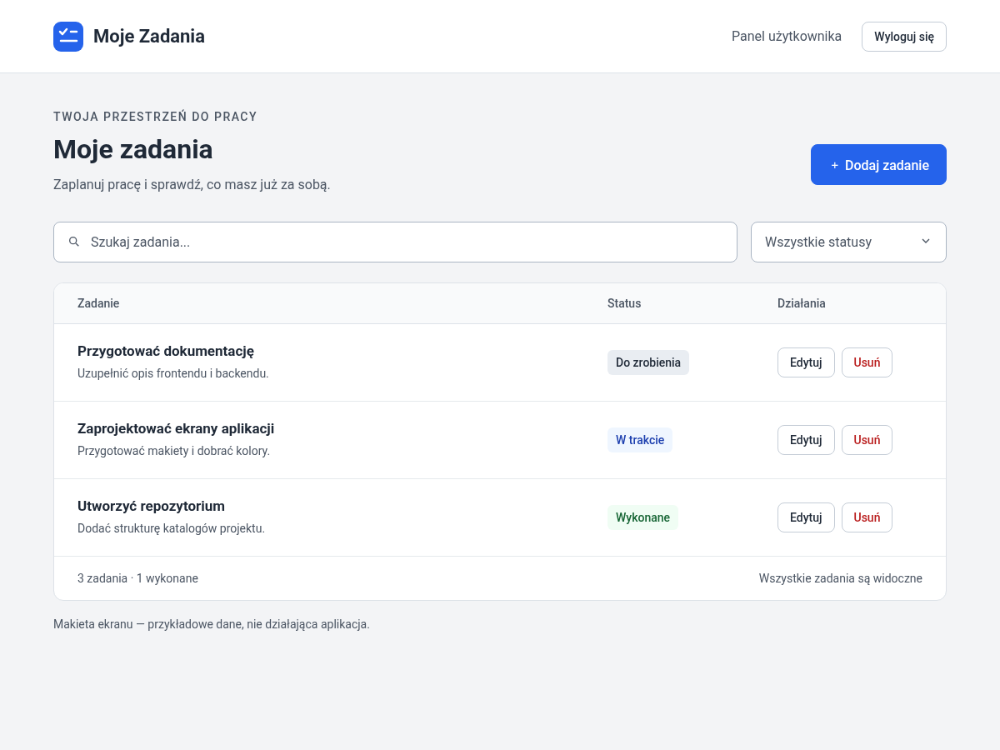
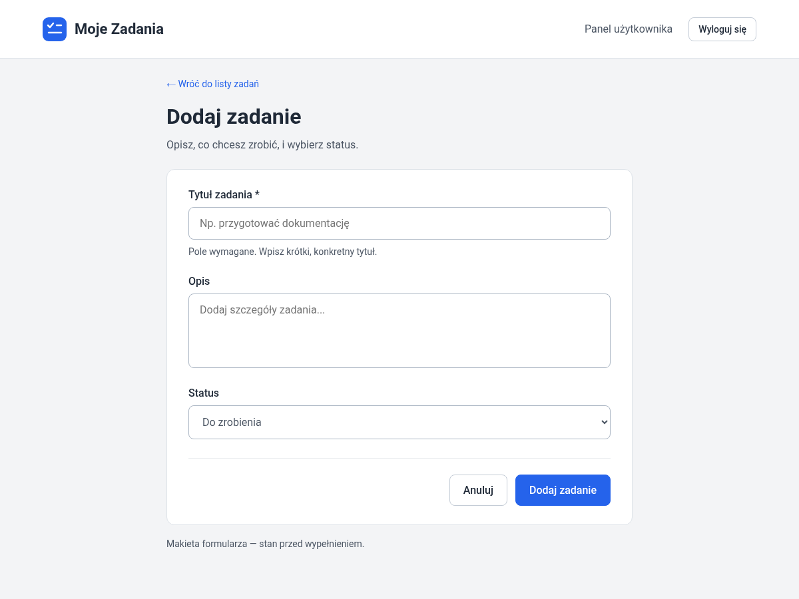
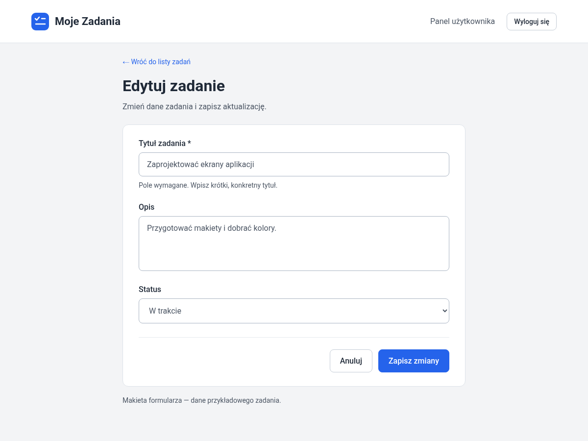
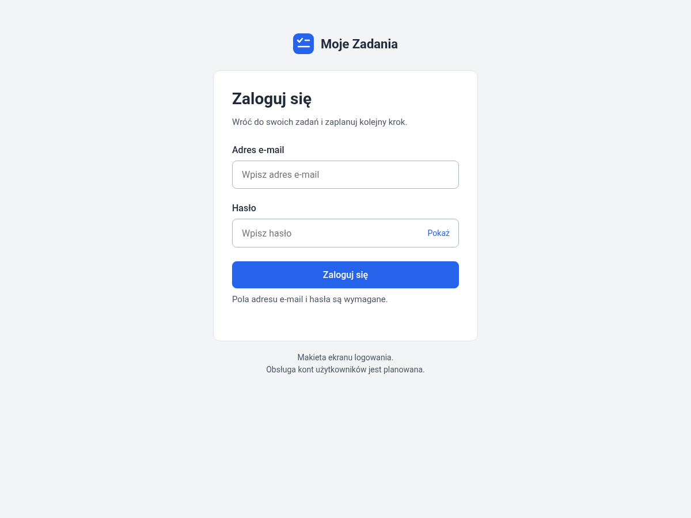
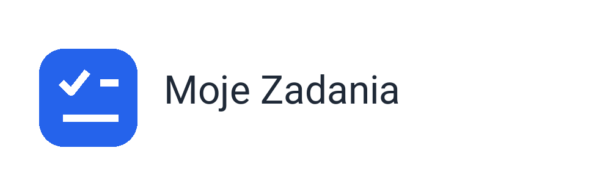

# Projekt wyglądu aplikacji

## Ogólny pomysł

Chcę, żeby aplikacja „Moje Zadania” była prosta i czytelna. Najważniejsze elementy to lista zadań i przycisk dodawania nowego zadania. Wybrałem jasne tło, ciemny tekst i niebieskie przyciski. Przygotowane obrazy to makiety, a nie działające ekrany aplikacji.

## Paleta kolorów

| Rola | Kolor HEX | Zastosowanie |
|---|---|---|
| Kolor główny | `#2563EB` | Główne przyciski, linki i znak aplikacji |
| Kolor dodatkowy | `#166534` | Tekst oznaczenia wykonanych zadań |
| Tło aplikacji | `#F3F4F6` | Tło ekranu |
| Tło kart i formularzy | `#FFFFFF` | Lista zadań i formularze |
| Tekst główny | `#1F2937` | Nagłówki, opisy i etykiety |
| Tekst pomocniczy | `#4B5563` | Dodatkowe informacje |
| Tekst na przyciskach | `#FFFFFF` | Napisy na niebieskich przyciskach |
| Kolor błędu | `#B91C1C` | Komunikaty o błędach i przycisk usuwania |
| Tło statusu „Wykonane” | `#F0FDF4` | Jasnozielone oznaczenie statusu |
| Tło statusu „W trakcie” | `#EFF6FF` | Jasnoniebieskie oznaczenie statusu |
| Tekst statusu „W trakcie” | `#1E40AF` | Napis na oznaczeniu statusu |
| Tło statusu „Do zrobienia” | `#E9EDF2` | Neutralne oznaczenie statusu |

Nie chcę oznaczać statusów tylko kolorem. Każdy status ma również tekst: „Do zrobienia”, „W trakcie” lub „Wykonane”.

### Sprawdzenie kontrastu

Współczynniki obliczono na podstawie względnej luminancji kolorów według metody WCAG. Wyniki są zaokrąglone do dwóch miejsc po przecinku. Dla zwykłego tekstu przyjąłem minimum 4,5:1 (poziom AA).

| Tekst | Tło | Kontrast | Wynik AA dla zwykłego tekstu |
|---|---|---|---|
| `#1F2937` | `#F3F4F6` | 13,34:1 | Spełnia |
| `#1F2937` | `#FFFFFF` | 14,68:1 | Spełnia |
| `#FFFFFF` | `#2563EB` | 5,17:1 | Spełnia |
| `#4B5563` | `#FFFFFF` | 7,56:1 | Spełnia |
| `#4B5563` | `#F3F4F6` | 6,87:1 | Spełnia |
| `#166534` | `#F0FDF4` | 6,81:1 | Spełnia |
| `#B91C1C` | `#FFFFFF` | 6,47:1 | Spełnia |

Kolory można ponownie sprawdzić w [WebAIM Contrast Checker](https://webaim.org/resources/contrastchecker/). Powyższe wyniki dotyczą wskazanych par kolorów, a nie pełnego audytu dostępności aplikacji.

## Czcionki

Wybrałem [Roboto z Google Fonts](https://fonts.google.com/specimen/Roboto).

- **Nagłówki:** Roboto, grubość 700, rozmiar 28–32 px; nagłówki sekcji 20–24 px.
- **Treść:** Roboto, grubość 400, rozmiar 16 px.
- **Przyciski i etykiety:** Roboto, grubość 500.
- **Informacje pomocnicze:** Roboto, rozmiar 14 px w docelowej aplikacji.

Wybrałem tę czcionkę, ponieważ ma prosty wygląd i obsługuje polskie znaki. Jedna rodzina czcionki pozwala zachować spójność, a większy rozmiar i pogrubienie pomagają odróżnić nagłówki od treści.

## Makiety ekranów

### Lista zadań

Na górze umieściłem znak aplikacji, jej nazwę i przycisk wylogowania. Niżej znajdują się nagłówek „Moje zadania”, przycisk „Dodaj zadanie”, wyszukiwarka oraz filtr statusu.

Każde zadanie ma tytuł, krótki opis, status i przyciski „Edytuj” oraz „Usuń”. Przykładowe zadania pokazują trzy różne statusy. W działającej aplikacji usunięcie będzie wymagać potwierdzenia, a pusta lista będzie zawierać komunikat i zachętę do dodania pierwszego zadania.



### Formularz dodawania zadania

Formularz zawiera tytuł, opis i wybór statusu. Tytuł jest wymagany. Główna akcja to „Dodaj zadanie”, a „Anuluj” pozwala wrócić bez zapisywania. Przy pustym tytule planuję wyświetlać komunikat „Wpisz tytuł zadania”.



### Formularz edycji zadania

Ten ekran ma taki sam układ jak formularz dodawania. Pola zawierają obecne dane przykładowego zadania, a główny przycisk ma napis „Zapisz zmiany”. Przycisk powrotu prowadzi do listy zadań.



### Ekran logowania

Na środku ekranu znajduje się formularz z polami adresu e-mail i hasła oraz przyciskiem „Zaloguj się”. Hasło będzie domyślnie ukryte, a opcja „Pokaż” pozwoli je odsłonić. Przy nieudanym logowaniu planuję komunikat „Nie udało się zalogować. Sprawdź adres e-mail i hasło”.

Logowanie jest propozycją wyglądu. Jego działanie wymaga późniejszego przygotowania obsługi kont w backendzie.



## Logo

Znak przedstawia listę zadań z zaznaczoną pozycją. Obok umieściłem nazwę „Moje Zadania”. Niebieski kolor nawiązuje do przycisków aplikacji, a prosty kształt można wykorzystać również bez napisu, np. w nagłówku na telefonie.



## Obsługa i wersja mobilna

Makiety przedstawiają wersję komputerową. W przyszłej wersji mobilnej planuję układ w jednej kolumnie, formularze dopasowane do szerokości ekranu i listę zadań w formie kart. Wyszukiwarka i filtr będą ustawione jeden pod drugim.

Pola formularzy będą miały etykiety, a przyciski czytelne nazwy. Planuję także widoczne zaznaczenie elementu przy obsłudze klawiaturą. Nie polegam wyłącznie na kolorach przy oznaczaniu statusów.

## Pliki materiałów

```text
docs/
├── design.md
└── images/
    ├── lista-zadan.png
    ├── dodawanie-zadania.png
    ├── edycja-zadania.png
    ├── logowanie.png
    └── logo.png
```

Materiały są propozycją wyglądu aplikacji do dalszej realizacji. Makiety i dokumentację przygotowano z pomocą AI.
