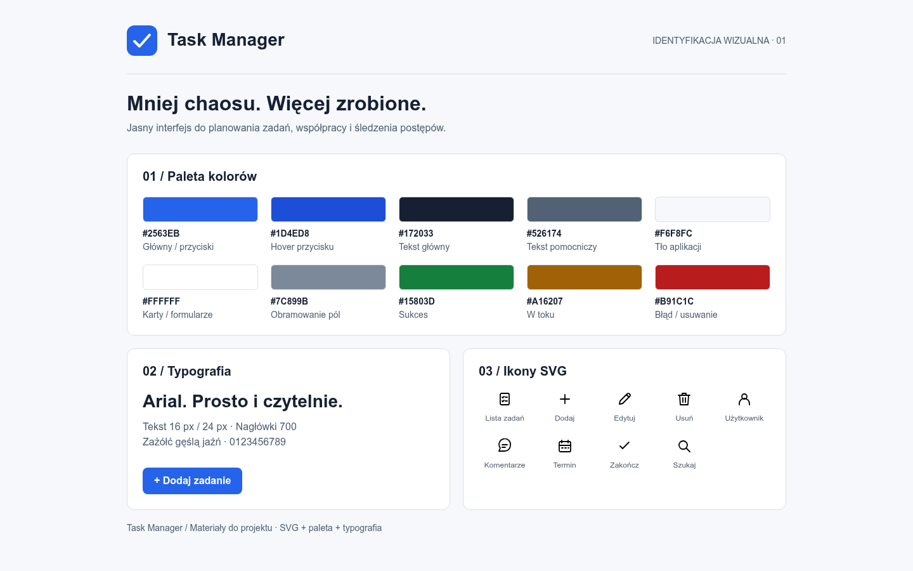

# Wygląd aplikacji Task Manager

## Koncepcja
Prosty, jasny interfejs aplikacji do zarządzania zadaniami. Niebieski kolor wyróżnia główne akcje, a znak wyboru w logo nawiązuje do ukończenia zadania. Materiały przygotowano jako propozycję do wdrożenia; nie zmieniają jeszcze interfejsu aplikacji.

## Paleta kolorów
| Zastosowanie | HEX |
| --- | --- |
| Główny / przyciski | `#2563EB` |
| Hover przycisku | `#1D4ED8` |
| Tekst główny | `#172033` |
| Tekst pomocniczy | `#526174` |
| Tło aplikacji | `#F6F8FC` |
| Karty / formularze | `#FFFFFF` |
| Obramowanie pól | `#7C899B` |
| Sukces | `#15803D` |
| W toku | `#A16207` |
| Błąd / usuwanie | `#B91C1C` |

Kolory statusów stosujemy razem z tekstem: „Do zrobienia”, „W toku”, „Gotowe”. Błędy opisujemy komunikatem, a nie tylko kolorem. Przycisk główny: białe litery na tle #2563EB; hover: #1D4ED8. Tekst statusów wyświetlamy na białym tle. Obramowania pól: #7C899B na białym tle.

## Typografia
- Nagłówki i tekst: **Arial**; zastępczo **Helvetica**, następnie `sans-serif`.
- Bez zewnętrznych plików fontów i zależności sieciowych.
- H1: 32 px / 40 px, pogrubienie 700.
- H2: 24 px / 32 px, pogrubienie 700.
- Tekst i przyciski: 16 px / 24 px; tekst 400, przyciski 700.
- Tekst pomocniczy: 14 px / 20 px, grubość 400.

```css
body {
  font-family: Arial, Helvetica, sans-serif;
  font-size: 16px;
  line-height: 1.5;
  color: #172033;
  background: #F6F8FC;
}
```

## Logo
- `frontend/assets/logo.svg` — pełne logo na jasnym tle.
- `frontend/assets/logo-mark.svg` — sam symbol, np. na małym ekranie.
- Zachowujemy proporcje; minimalna wysokość 32 px; wolna przestrzeń wokół: co najmniej 8 px.
- Logo jest autorską grafiką SVG. Napis w pełnej wersji korzysta z Arial lub systemowego sans-serif.

## Ikony
Autorski zestaw SVG: rozmiar bazowy 24 × 24 px, linia 1,8 px, zaokrąglone końce.

| Plik w frontend/assets/icons/ | Zastosowanie |
| --- | --- |
| `tasks.svg` | Lista zadań |
| `plus.svg` | Dodaj |
| `edit.svg` | Edytuj |
| `trash.svg` | Usuń |
| `user.svg` | Użytkownik |
| `comment.svg` | Komentarze |
| `calendar.svg` | Termin |
| `check.svg` | Zakończ |
| `search.svg` | Szukaj |

Przyciski z ikoną powinny mieć obszar kliknięcia co najmniej 44 × 44 px oraz dostępną nazwę. Ikony używają `currentColor`; przy osadzeniu przez `` mają domyślny czarny kolor. Do zmiany koloru zgodnie z otaczającym tekstem można użyć SVG inline.

```html

<button type="button" aria-label="Dodaj zadanie">
  
</button>
```

## Układ i dostępność
- Odstępy: 4, 8, 12, 16, 24, 32, 48 px.
- Zaokrąglenie pól i przycisków: 8 px; kart: 12 px.
- Maksymalna szerokość treści: 1120 px; marginesy na telefonie: 16 px.
- Na małych ekranach jedna kolumna; nie ukrywamy podstawowych akcji.
- Widoczny fokus klawiatury: obrys 2 px #2563EB z odsunięciem 3 px.
- Podstawowe pary tekst/tło spełniają kontrast WCAG AA. Stany wskazujemy również tekstem lub ikoną.

## Podgląd

